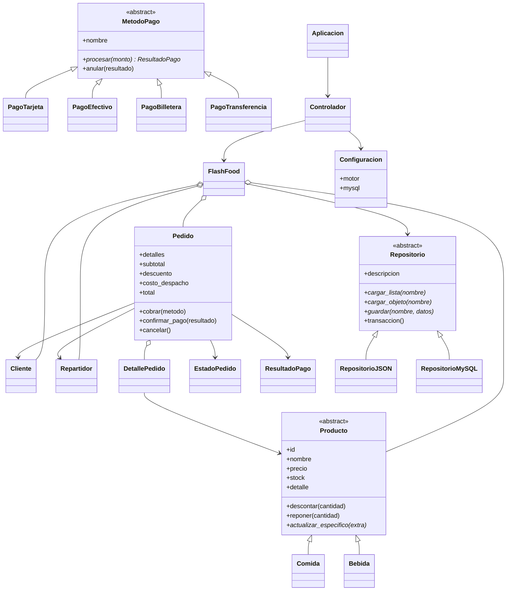
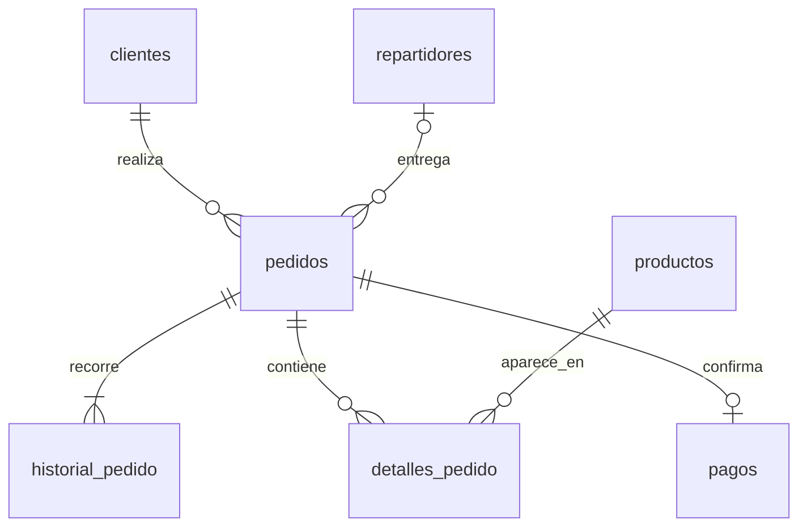

# Diagrama de clases

`PagoTransferencia` entra por el mismo contrato `MetodoPago`. `FlashFood.pagar` no tiene una rama por cada medio: recibe el objeto y el pedido llama a `procesar`.

`FlashFood` solo conoce el contrato `Repositorio`. `crear_repositorio` (en `persistencia/fabrica.py`) entrega `RepositorioJSON` o `RepositorioMySQL` según `config.ini`, y el resto del sistema no cambia.

## Modelo de datos en MySQL

`productos` guarda comida y bebida en una sola tabla (`tipo`, `categoria`, `mililitros`). `operacion` tiene una sola fila con hora punta y lluvia. El detalle está en `database/01_esquema.sql`.
